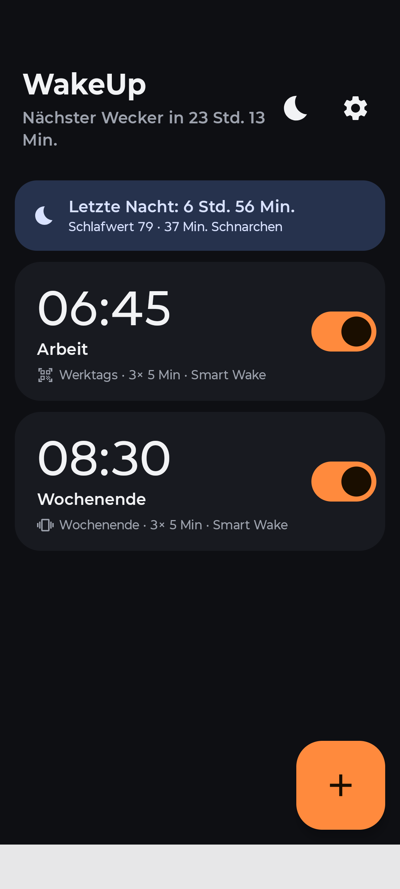
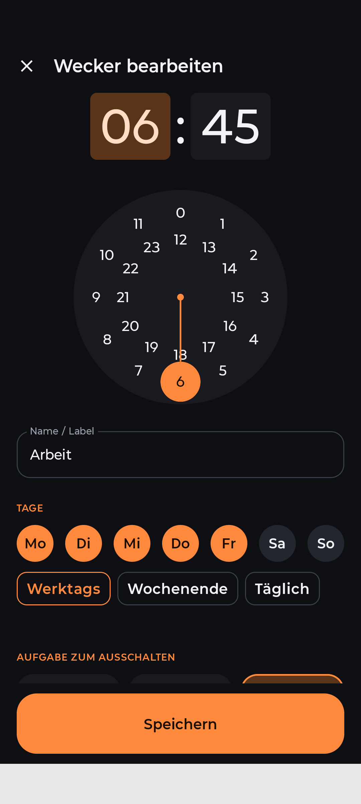
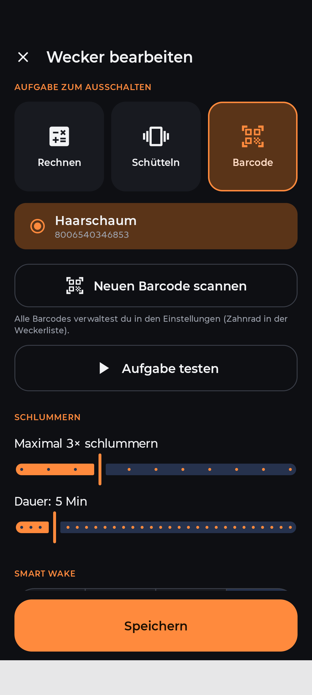
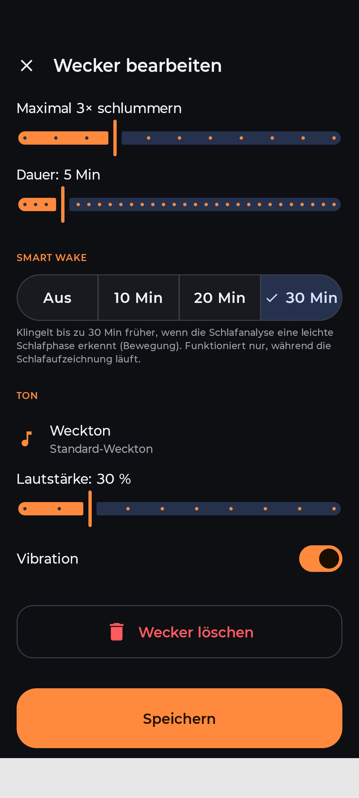
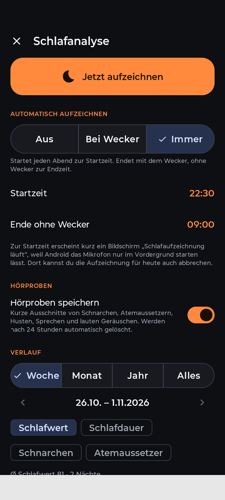
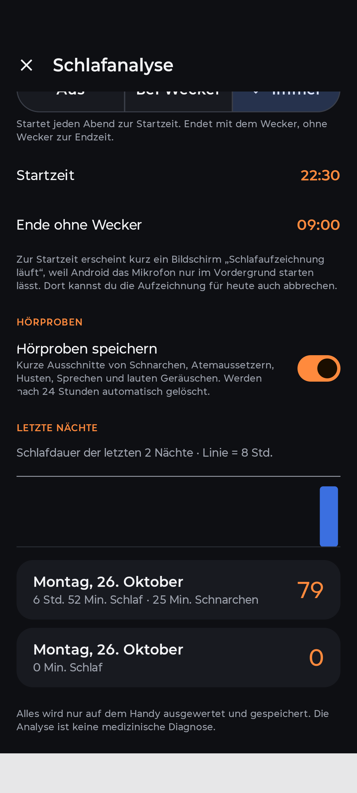
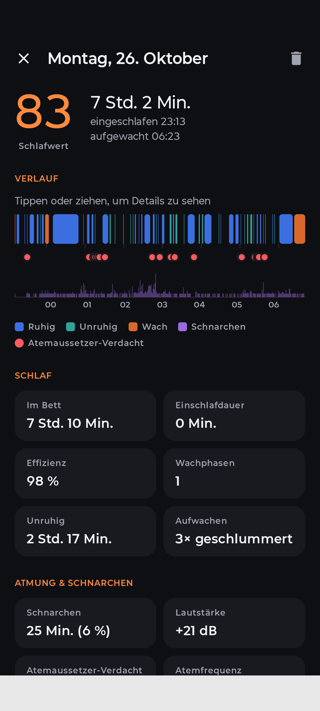

# WakeUp

Der Android-Wecker, der garantiert weckt: Er lässt sich nicht im Halbschlaf wegdrücken, sondern
nur durch eine Aufgabe beenden. Dazu eine Schlafanalyse, die die Nacht offline auswertet und
morgens einen Bericht zeigt.

**Download:** Die aktuelle APK liegt unter [Releases](../../releases/latest).

  

Die Startseite zeigt, wann der nächste Wecker klingelt, und darunter die Karte **„Letzte
Nacht“** mit Schlafdauer, Schlafwert und Schnarchzeit. Jede Wecker-Karte zeigt Uhrzeit, Name,
die gewählte Aufgabe, die Tage, die Schlummer-Einstellung und ob Smart Wake aktiv ist. Über **+**
kommt ein neuer Wecker dazu, oben rechts geht es zur Schlafanalyse (Mond) und zu den
Einstellungen (Zahnrad).

## Funktionen

- **Mehrere Wecker** mit Uhrzeit, Name und Wochentagen (Werktags / Wochenende / Täglich oder frei
  wählbar, ohne Tage einmalig). Die Uhrzeit wird über eine große 24-Stunden-Uhr eingestellt.
- **Aufgaben zum Ausschalten**
  - **Rechnen** – leicht, mittel oder schwer, 1–10 Aufgaben. Eine falsche Antwort bringt eine neue
    Aufgabe.
  - **Schütteln** – 10–150 Mal.
  - **Barcode / QR-Code** – einen Code scannen, der woanders liegt, z. B. die Zahnpasta im Bad.
    Beliebig viele Codes lassen sich mit Namen speichern. Mit Taschenlampe, und als Notausgang
    gibt es schwere Matheaufgaben, falls der Code nicht greifbar ist.
  - **Keine** – ein Tipp auf *Ausschalten* genügt.
  - **Aufgabe testen** probiert die gewählte Aufgabe aus, ohne dass ein Wecker klingelt.
- **Schlummern begrenzt** – Anzahl (0–10) und Dauer (1–30 Min) pro Wecker. Ein schlummernder
  Wecker lässt sich in der App weder ausschalten noch bearbeiten.
- **Kein Schummeln** – keine Ausschalten-Aktion in der Benachrichtigung, die Zurück-Taste ist
  gesperrt, beim Klingeln landet man immer auf dem Weckbildschirm. Schlummern liegt ganz oben,
  Ausschalten ganz unten, damit man im Halbschlaf nicht den falschen Knopf erwischt. Wer die
  Aufgabe 30 Sekunden liegen lässt, fängt von vorn an.
- **Weckton, Lautstärke und Vibration** pro Wecker. Die Lautstärke wird beim Klingeln erzwungen.
- **Klingelt zuverlässig** – auch über dem Sperrbildschirm und nach einem Neustart, selbst vor dem
  ersten Entsperren.
- **Standard für neue Wecker** – Uhrzeit, Tage, Aufgabe, Schlummern, Smart Wake und Ton, mit denen
  ein neuer Wecker startet.
- **Smart Wake** – weckt bis zu 10, 20 oder 30 Minuten früher, wenn die Schlafanalyse eine leichte
  Schlafphase erkennt.
- **Nach dem Ausschalten** öffnet sich direkt der Schlafbericht, falls die Nacht aufgezeichnet
  wurde.
- Dunkles, schlichtes Design mit großen, weit auseinanderliegenden Knöpfen.

## Wecker bearbeiten

  
  
  

1. **Uhrzeit, Name und Tage** – Stunde und Minute über die Uhr wählen, einen Namen vergeben und
   die Wochentage antippen oder per Schnellwahl setzen.
2. **Aufgabe und Schlummern** – *Rechnen*, *Schütteln*, *Barcode* oder *Keine* wählen, beim Barcode
   einen gespeicherten Code auswählen oder einen neuen scannen. Darunter Anzahl und Dauer des
   Schlummerns.
3. **Smart Wake und Ton** – Smart-Wake-Fenster, Weckton, Lautstärke und Vibration.

## Schlafanalyse

  
  
  

Das Handy hört über das Mikrofon mit und erkennt Geräusche mit Rhythmus-Analyse und einem
KI-Modell, das komplett offline läuft. Liegt es auf der Matratze, hilft zusätzlich der
Bewegungssensor.

1. **Aufzeichnung** – manuell mit *Jetzt aufzeichnen* oder automatisch (*Bei Wecker* oder
   *Immer*) ab einer Startzeit. Im **Verlauf** lassen sich Schlafwert, Schlafdauer, Schnarchen und
   Atemaussetzer pro Woche, Monat, Jahr oder insgesamt vergleichen.
2. **Letzte Nächte** – Balkendiagramm der Schlafdauer und die Liste der Nächte mit Schlafdauer,
   Schnarchzeit und Schlafwert.
3. **Schlafbericht** – Schlafwert, Schlafdauer, Einschlaf- und Aufwachzeit und die Nacht als
   Zeitleiste (ruhig, unruhig, wach, Schnarchen). Dazu Kacheln zu Einschlafdauer, Effizienz,
   Wachphasen, Unruhe, Atemfrequenz, Atemaussetzer-Verdacht, Husten, Sprechen im Schlaf und
   Störgeräuschen.

Auf Wunsch speichert die App kurze Hörproben von Schnarchen, Husten oder Sprechen, um sie morgens
anzuhören. Sie werden nach 24 Stunden gelöscht.

Die Schlafanalyse ist keine medizinische Diagnose. Mehr dazu: [docs/SCHLAFANALYSE.md](docs/SCHLAFANALYSE.md).

## Datenschutz

Alles bleibt auf dem Handy, nichts wird hochgeladen. Nächte, Berichte und Hörproben liegen im
verschlüsselten App-Speicher und sind vom Android-Cloud-Backup ausgeschlossen. Wie lange Nächte
gespeichert bleiben, lässt sich einstellen (3 Monate, 1 Jahr, 2 Jahre oder immer), und **Alle
Schlafdaten löschen** entfernt alles auf einmal. Hörproben sind standardmäßig aus.

## Berechtigungen

Beim ersten Start fragt die App nach Benachrichtigungen, exakten Weckern, Vollbild-Anzeige und
„Über anderen Apps einblenden“ – ohne Letzteres öffnet sich der Wecker bei entsperrtem Handy nur
über die Benachrichtigung. Die Kamera wird für die Barcode-Aufgabe gebraucht, das Mikrofon für die
Schlafanalyse.

Läuft ab Android 8.0.
