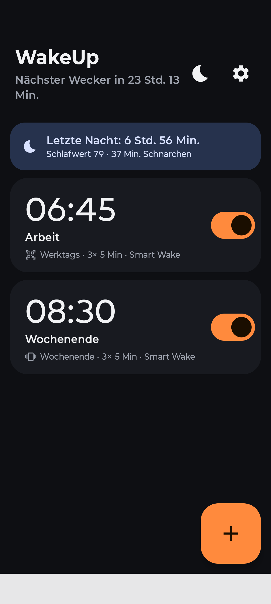
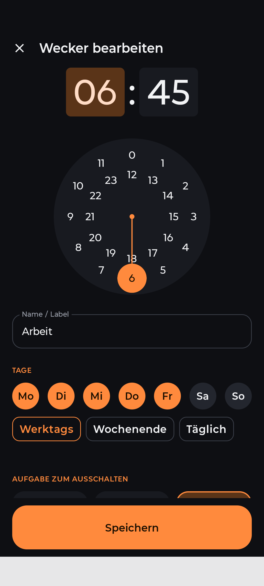
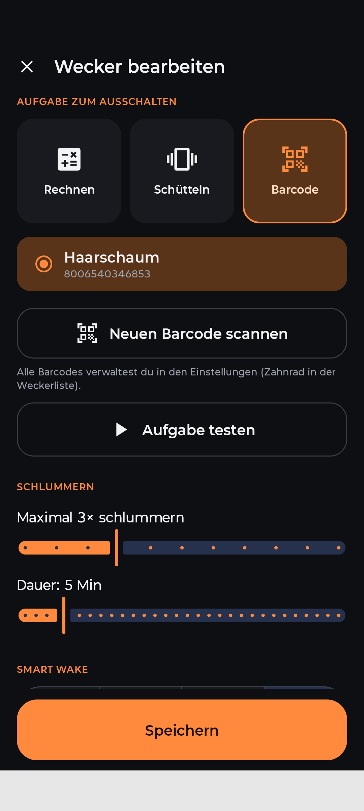
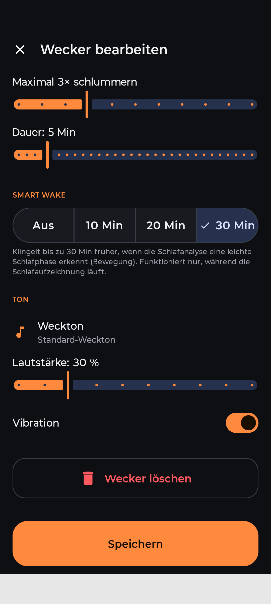
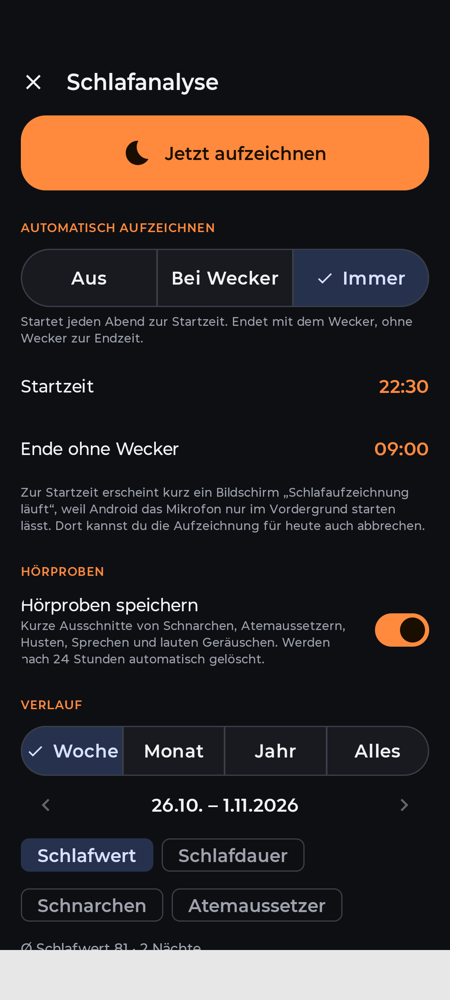
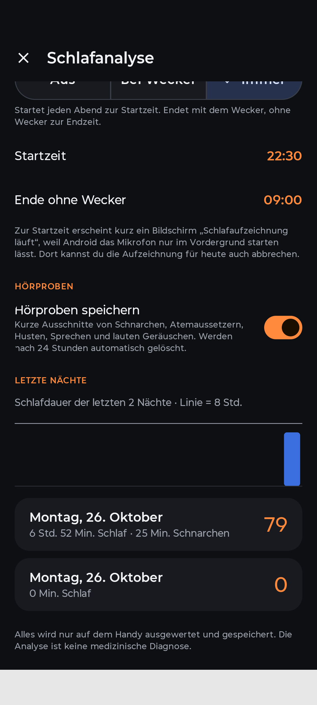
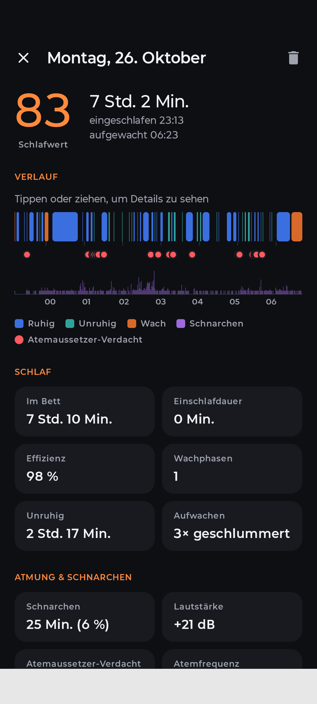

# WakeUp

Android-Wecker der garantiert weckt: Der Wecker lässt sich nicht im Halbschlaf wegdrücken,
sondern nur durch eine Aufgabe beenden.

<p align="center">
  
</p>

Die Startseite zeigt, wann der nächste Wecker klingelt, und darunter die Karte **„Letzte
Nacht“** mit Schlafdauer, Schlafwert und Schnarchzeit (antippen öffnet den Bericht). Jede
Wecker-Karte zeigt Uhrzeit, Name, ein Symbol für die Aufgabe, die Tage, die Schlummer-Einstellung
und ob Smart Wake aktiv ist; mit dem Schalter wird der Wecker ein- und ausgeschaltet, über **+**
kommt ein neuer dazu. Oben rechts geht es zur Schlafanalyse (Mond) und zu den Einstellungen (Zahnrad).

## Funktionen

- **Mehrere Wecker** mit Uhrzeit, Name/Label und Wochentagen (Werktags / Wochenende / Täglich
  oder frei wählbar; ohne Tage = einmalig). Die Uhrzeit wird über eine große 24-Stunden-Uhr
  eingestellt: erst die Stunde (innerer Ring 12–23, äußerer 0–11), dann die Minuten.
- **Aufgaben zum Ausschalten**
  - **Rechnen** – Leicht / Mittel / Schwer, 1–10 Aufgaben. Falsche Antwort ⇒ neue Aufgabe.
  - **Schütteln** – 10–150 Schüttler.
  - **Barcode / QR-Code** – in den **Einstellungen** (Zahnrad) beliebig viele Codes mit Namen
    speichern (z. B. „Zahnpasta im Bad“) und pro Wecker einen davon auswählen. Mit Taschenlampe;
    als Notausgang gibt es 6 schwere Matheaufgaben, falls der Code nicht greifbar ist.
    Neue Codes lassen sich auch direkt beim Bearbeiten des Weckers scannen.
  - **Aufgabe testen** führt die gewählte Aufgabe einmal probeweise aus, ohne dass ein Wecker klingelt.
- **Schlummern begrenzt** – maximale Anzahl (0–10) und Dauer (1–30 Min) pro Wecker. Während ein
  Wecker schlummert, kann er in der App weder ausgeschaltet noch bearbeitet werden.
- **Weckbildschirm** – der Schlummer-Button liegt ganz oben, der Button zum Ausschalten ganz
  unten, damit man im Halbschlaf nicht den falschen erwischt.
- **Kein Schummeln**: keine Ausschalten-Aktion in der Benachrichtigung, Zurück-Taste blockiert,
  die App leitet beim Klingeln immer zum Weckbildschirm. Bei Mathe/Schütteln wird es leiser,
  solange du die Aufgabe bearbeitest (beim Barcode bleibt es laut). Kommt 30 s lang keine
  Eingabe (Tippen, Schütteln oder ein gescannter Code), erscheint wieder der Weckbildschirm mit
  Schlummern und Ausschalten, und die Aufgabe beginnt von vorn.
- **Nach dem Ausschalten** öffnet sich die App: Lief in der Nacht die Schlafaufzeichnung, erscheint
  direkt der Schlafbericht, sonst die Weckerliste. Ist das Handy gesperrt, erst nach dem Entsperren.
- Weckton, Lautstärke (wird beim Klingeln erzwungen) und Vibration pro Wecker.
- Klingelt auch über dem Sperrbildschirm und nach einem Neustart (auch vor dem Entsperren).
- **Schlafanalyse** (Mond-Symbol): zeichnet die Nacht über das Mikrofon auf – automatisch
  (*Aus* / *Bei Wecker* / *Immer*, ab einer Startzeit) oder manuell – und zeigt morgens einen
  Bericht: Schlafdauer, Einschlafzeit, Wachphasen, Unruhe, Schnarchzeit, Atemaussetzer-Verdacht,
  Atemfrequenz, Husten, Sprechen im Schlaf, Störgeräusche, „Licht aus“ und einen Schlafwert.
  Geräusche erkennt die App mit Rhythmus-Analyse und dem KI-Modell YAMNet (offline); liegt das
  Handy auf der Matratze, hilft der Bewegungssensor. Hörproben werden nach 24 Stunden gelöscht.
  Alles bleibt auf dem Handy; keine medizinische Diagnose.
  Details: [docs/SCHLAFANALYSE.md](docs/SCHLAFANALYSE.md).
- **Smart Wake** pro Wecker: klingelt bis zu 10/20/30 Min früher, wenn die Schlafanalyse eine
  leichte Schlafphase (Bewegung) erkennt. Funktioniert nur, während die Schlafaufzeichnung läuft.
- Dunkles, schlichtes UI mit großen, weit auseinanderliegenden Buttons.

### Wecker bearbeiten

<p align="center">
  
  
  
</p>

1. **Uhrzeit, Name und Tage** – Stunde und Minute über die Uhr wählen, ein Label vergeben und
   die Wochentage antippen oder per Schnellwahl *Werktags* / *Wochenende* / *Täglich* setzen.
2. **Aufgabe und Schlummern** – *Rechnen*, *Schütteln* oder *Barcode* wählen; beim Barcode einen
   gespeicherten Code auswählen oder einen neuen scannen. *Aufgabe testen* probiert die Aufgabe
   aus. Darunter Anzahl und Dauer des Schlummerns.
3. **Smart Wake und Ton** – Smart-Wake-Fenster (*Aus* / 10 / 20 / 30 Min), Weckton, Lautstärke
   und Vibration. Ganz unten lässt sich der Wecker löschen.

### Schlafanalyse

<p align="center">
  
  
  
</p>

1. **Aufzeichnung** – *Jetzt aufzeichnen* startet sofort. Automatisch geht es *Aus*, *Bei Wecker*
   oder *Immer*, jeweils ab der Startzeit; ohne Wecker endet die Aufzeichnung zur eingestellten
   Endzeit. Zur Startzeit erscheint kurz der Bildschirm „Schlafaufzeichnung läuft“ (Android
   startet das Mikrofon nur im Vordergrund), dort lässt sich die Nacht auch abbrechen.
   *Hörproben speichern* behält kurze Ausschnitte von Schnarchen, Atemaussetzern, Husten,
   Sprechen und lauten Geräuschen für 24 Stunden. Im **Verlauf** lassen sich Schlafwert,
   Schlafdauer, Schnarchen und Atemaussetzer pro Woche, Monat, Jahr oder insgesamt vergleichen.
2. **Letzte Nächte** – Balkendiagramm der Schlafdauer (Linie = 8 Std.) und die Liste der Nächte
   mit Schlafdauer, Schnarchzeit und Schlafwert. Antippen öffnet den Bericht.
3. **Schlafbericht** – Schlafwert, Schlafdauer, Einschlaf- und Aufwachzeit. Der **Verlauf** zeigt
   die Nacht als Zeitleiste (Ruhig / Unruhig / Wach / Schnarchen), markiert Atemaussetzer-Verdacht
   und darunter die Lautstärke; Tippen oder Ziehen zeigt Details. Darunter Kacheln zu Schlaf
   (Im Bett, Einschlafdauer, Effizienz, Wachphasen, Unruhe, Schlummern) sowie Atmung und
   Schnarchen. Über den Papierkorb lässt sich die Nacht löschen.

## Bauen & installieren

Jeder Push baut per GitHub Actions eine Debug-APK (Tab **Actions** → letzter Lauf →
Artefakt `WakeUp-debug-apk`). Lokal mit installiertem Android SDK:

```sh
./gradlew assembleDebug        # APK: app/build/outputs/apk/debug/app-debug.apk
./gradlew testDebugUnitTest    # Unit-Tests
```

Beim ersten Start die angezeigten Berechtigungen erlauben (Benachrichtigungen, exakte Wecker,
Vollbild-Anzeige, „Über anderen Apps einblenden“ – ohne Letzteres öffnet sich der Wecker bei
entsperrtem Handy nicht von selbst, sondern nur über die Benachrichtigung). Für die Barcode-Aufgabe wird die Kamera benötigt, für die Schlafanalyse das Mikrofon.

## Versionierung

Die Version wird automatisch aus der Git-Historie berechnet: `versionName` = `<Basis>.<Anzahl Commits>`
(z. B. `1.1.3`), `versionCode` = Anzahl Commits. Jeder Commit erzeugt so eine höhere Version, die
sich über die installierte App drüberinstallieren lässt. Für größere Sprünge die Basisversion
`baseVersion` in `app/build.gradle.kts` anheben. Die APK heißt `WakeUp-<Version>-debug.apk`,
die aktuelle Version steht in der App unter Einstellungen → Über.

## Technik

Kotlin, Jetpack Compose (Material 3), `AlarmManager.setAlarmClock` für exakte Wecker,
Foreground-Service für Ton/Vibration, CameraX + ML Kit (offline) für Barcodes,
`AudioRecord` + eigene Signalverarbeitung (FFT, Rhythmus-Erkennung) und TensorFlow Lite mit
[YAMNet](https://github.com/tensorflow/models/tree/master/research/audioset/yamnet) (Apache 2.0)
für die Schlafanalyse.
Mindestens Android 8.0 (API 26).
